# 上坡、坡頂、下坡與落地

## 一句話結論

坡道段由 IMU 俯仰角切出幾個窗口（爬坡、坡頂、下坡尾段、陡坡、落地），各層依窗口接手；最終版坡上全程與落地後最初 1.2 m 的舵量由 land4 以「上層直線的絕對航向」為基準全權決定，落地後再交給 bottom_owner 上限與彎 4 帶狀 [src: raw/project/snapshot-20261123d/land4.py#L1-L8] [src: raw/project/snapshot-20261123d/land4.json#key=enabled] [src: raw/project/snapshot-20261123d/live_pid.py#L2285-L2289]。

## 內容

名詞：
- 俯仰（pitch_rel）：IMU 俯仰減去平地基準 flat_pitch_deg 1.0°；上坡為正 [src: raw/project/snapshot-20261123d/imu_boost.py#L9-L10] [src: raw/project/snapshot-20261123d/imu_boost.json#key=flat_pitch_deg]。
- 路段狀態（dash_route route）：WAIT_CLIMB（平地圈）→ CLIMBED（俯仰 ≥ 8° 持續 2 s，坡頂前約 1 s）→ OPEN（上層段）→ DONE（下坡起）[src: raw/project/snapshot-20261123d/crest_latch.py#L8-L10] [src: raw/project/snapshot-20261123d/heading_hold.py#L16]。
- lap_pos 地標 RAMP、DOWN、LAND8：上坡起點、下坡口、落地點，見 [[control/lap-position]]。

### 下坡相關旗標（live_pid 主迴圈）[src: raw/project/snapshot-20261123d/live_pid.py#L2118-L2150]
- `down_tail`：最後一次俯仰 < −5° 之後 4 s 內 [src: raw/project/snapshot-20261123d/live_pid.py#L2124] [src: raw/project/snapshot-20261123d/live_pid.py#L2138]。
- `down_steep`：本次下坡曾 < DOWN_STEEP −8° [src: raw/project/snapshot-20261123d/live_pid.py#L113] [src: raw/project/snapshot-20261123d/live_pid.py#L2136]。
- `down_level`（落地時刻 down_level_t0）：陡坡之後俯仰第一次回到 ≥ −8° 的時刻；同時鎖住落地航向 `_bm_yaw0` [src: raw/project/snapshot-20261123d/live_pid.py#L2137] [src: raw/project/snapshot-20261123d/live_pid.py#L2140-L2146]。
- `downhill`：down_tail 且落地未滿 DOWN_RELEASE_S 0.8 s；超過後下坡專用規則（速度縮放、D 限制等）解除，但遺失格的 DOWNHILL_HOLD 仍用 4 s 尾段 [src: raw/project/snapshot-20261123d/live_pid.py#L2126-L2133] [src: raw/project/snapshot-20261123d/live_pid.py#L2148]。
- 平地短暫下沉由 flat_dip_guard 過濾，不當成下坡 [src: raw/project/snapshot-20261123d/live_pid.py#L2121-L2123]。

### 狀態流程

```mermaid
flowchart LR
  A[平地 WAIT_CLIMB<br/>yaw_inner 平地模式] -->|俯仰≥5° 0.2s| B[爬坡<br/>imu_boost / lap_speed 坡道區<br/>yaw_inner climb_gain<br/>i_ramp 釋放右彎積分]
  B -->|≥8° 2s| C[CLIMBED 坡頂前<br/>crest_latch 中點<br/>yaw_inner 坡頂保持]
  C --> D[OPEN 上層段<br/>upper_single / heading_hold<br/>land4 記錄上層直線航向]
  D -->|俯仰<-5° down_tail| E[下坡 SLOPE<br/>land4 slope 全權<br/>下坡各層只是輸入]
  E -->|俯仰回≥-8° 且 ≥1.2m 或 ≥1.0s| F[落地 LAND 0~1.2m<br/>land4 land 全權<br/>bottom_owner 範圍開始]
  F -->|1.2+0.3m 交還| G[彎 4<br/>bottom_owner 右上限<br/>lap_ff4 帶狀 1.2m 起]
  G -->|curve_map 彎4 FLOOR 或 3.8s| H[彎 4 帶狀至 193°]
```


（流程依程式整理；條件數字見下列各段的引用。）

### 上坡
- 【現役】imu_boost：俯仰 ≥ on_deg 5° 持續 hold_s 0.2 s 進入 uphill，< off_deg 3° 回平地；資料過期（> max_age_s 0.3 s）用基本 PWM；uphill_pwm 25、cap_pwm 25、PWM 每秒最多變 10 [src: raw/project/snapshot-20261123d/imu_boost.py#L9-L15] [src: raw/project/snapshot-20261123d/imu_boost.json#L2-L11] [src: raw/project/snapshot-20261123d/imu_boost.json#key=pwm_rate]。
- 【現役】lap_speed 坡道區：RAMP+0.3～1.9 m 油門 100（allow_climb、err_guard 0.4、上升率 70 PWM/s）；坡頂區 RAMP+2.3～4.4 m 為 33 [src: raw/project/snapshot-20261123d/lap_speed.json#L64-L71] [src: raw/project/snapshot-20261123d/lap_speed.json#L104-L111]。油門層之間的優先關係見 [[control/speed-control]]。
- 【現役】yaw_inner 爬坡模式：俯仰 ≥ 5° 改用 climb_gain 0.048 [src: raw/project/snapshot-20261123d/yaw_inner.json#L21-L22]，見 [[control/yaw-inner]]。
- 【現役】i_ramp 爬坡積分釋放：俯仰 ≥ 8° 持續 1.0 s 後，PID 積分以 tau 0.5 s 衰減（只釋放右轉的正值），俯仰 < 4° 結束；只改積分狀態、不改當格舵量 [src: raw/project/snapshot-20261123d/i_ramp.py#L3-L16] [src: raw/project/snapshot-20261123d/i_ramp.json#L1]。原因：彎 3 結束在坡腳，每次爬坡起始積分 +40 µs，把車留在右側直到坡頂 [src: raw/project/snapshot-20261123d/i_ramp.py#L3-L6]。

### 坡頂
- 【現役】crest_latch：坡頂兩線中點路徑一旦被採用（俯仰 ≥ 8° 且 CLIMBED），之後正常路徑格也改用中點，最多 1.5 s；中點不可用時當遺失格處理 [src: raw/project/snapshot-20261123d/crest_latch.py#L8-L18] [src: raw/project/snapshot-20261123d/crest_latch.json#L1]。路徑面細節見 [[path/vision-failure-modes]]。
- 【現役】yaw_inner 坡頂保持：俯仰曾 ≥ 8° 且已爬 ≥ 2.0 s 後 1.0 s 內，相機命令以 400 µs/s 限速跟隨、內迴圈保持其轉速 [src: raw/project/snapshot-20261123d/yaw_inner.py#L67-L72] [src: raw/project/snapshot-20261123d/yaw_inner.json#L23-L27]。
- 上層段（OPEN）由 upper_single 控制，見 [[control/heading-hold]] 與 [[path/upper-dash-route]]。

### 下坡（SLOPE）
- 【現役】land4 slope 段：從第一個下坡格（down_tail）到落地，**擁有每一格（有效或遺失）**；跳變保護、down_straight、相機鏈的結果都不採用（它們的狀態照常運算）[src: raw/project/snapshot-20261123d/land4.py#L19-L20] [src: raw/project/snapshot-20261123d/land4.json#key=slope.enabled]。
- 參考航向 ref：上層直線最後 ref_s 1.2 s 的平均 IMU 航向（取樣條件：有效格且 heading_hold 啟動），至少 8 筆且範圍 ≤ 8°；否則本次不作用 [src: raw/project/snapshot-20261123d/land4.py#L142-L148] [src: raw/project/snapshot-20261123d/live_pid.py#L1460] [src: raw/project/snapshot-20261123d/land4.json#L5-L7]。
- 坡上距離 u＝下坡口起算距離 − slope_len_m 2.2（最大 −0.05）[src: raw/project/snapshot-20261123d/land4.py#L241-L242] [src: raw/project/snapshot-20261123d/land4.json#key=slope_len_m]。
- 落地撞擊時陀螺儀會飽和（±250 dps），單格航向跳變超過 3° 時以陀螺儀預測取代並記為偏移 [src: raw/project/snapshot-20261123d/land4.py#L24-L27] [src: raw/project/snapshot-20261123d/land4.json#key=spike_deg]。
- 被 land4 蓋過、但仍在層表中運算的下坡層（無參考或無 IMU 時才會送出）[src: raw/project/snapshot-20261123d/land4.py#L232-L234]：
  - downhill_dcap：D 項限 ±150 [src: raw/project/snapshot-20261123d/live_pid.py#L1548-L1553]。
  - downhill_speed：舵量偏移乘 3000／編碼器速度（不低於 0.75）[src: raw/project/snapshot-20261123d/downhill_speed.py#L12] [src: raw/project/snapshot-20261123d/live_pid.py#L1554-L1565]。
  - downhill_assist：誤差 > 0.4 時至少中心＋ASSIST_US，ASSIST_US 已設 0 [src: raw/project/snapshot-20261123d/downhill_speed.py#L22-L24] [src: raw/project/snapshot-20261123d/live_pid.py#L1566-L1569]。
  - downhill_dlimit：P+I 要右轉時 D 不能把它變成左轉 [src: raw/project/snapshot-20261123d/live_pid.py#L1570-L1574]。
  - downhill_gz：|gz| > 25 deg/s 時每 deg/s 反向 5 µs，上限 150，下坡起 0.5 s 內不作用 [src: raw/project/snapshot-20261123d/downhill_speed.py#L21] [src: raw/project/snapshot-20261123d/downhill_speed.py#L28-L34]。
  - down_straight：俯仰 ≤ −8° 時有效格限中心 ±300 µs [src: raw/project/snapshot-20261123d/down_straight.json#L1]，見 [[control/heading-hold]]。
- arc2.land.approach／pulse：下坡口 DOWN+1.5～3.0 m 抬高送出舵量下限（模擬間隙補償，使送出值 ≥ 直行點）；pulse 在 DOWN+1.85～3.0 m 依相機誤差把送出值抬到至多中心＋220 µs（前補償命令 ≤ 中心＋240）[src: raw/project/snapshot-20261123d/arc2.json#L214-L245] [src: raw/project/snapshot-20261123d/arc2.py#L717-L760]。json 說明寫 pulse「NOT deployed」，但 enabled true 且被呼叫，說明文字過時 [src: raw/project/snapshot-20261123d/arc2.json#L234-L245]。它排在 land4 之前，有 land4 參考時其結果被 land4 slope 段取代。
- 【曾用】arc2.pre（坡上預先右轉）：pre.enabled false，雖然 pre.r2.enabled true，物件不建立 [src: raw/project/snapshot-20261123d/arc2.json#L1213-L1214] [src: raw/project/snapshot-20261123d/arc2.py#L608-L612]，見 [[control/disabled-layers]]。
- 速度保護（downhill_guard：輪速 ≥ 6800 cps 時油門降到 5）屬速度層，見 [[control/speed-control]] [src: raw/project/snapshot-20261123d/speed_guard.json#key=downhill_guard]。

### 落地判定與 LAND 段
- land4 由 SLOPE 轉 LAND 需要 live_pid 的落地旗標，且（離下坡口 ≥ land_min_m 1.2 m 或坡上 ≥ land_min_s 1.0 s）；否則視為坡口俯仰回彈 [src: raw/project/snapshot-20261123d/land4.py#L129-L140] [src: raw/project/snapshot-20261123d/land4.py#L227-L230] [src: raw/project/snapshot-20261123d/land4.json#L634-L635]。這是 run-54cb 第 3 圈坡口誤判後加的防護 [src: raw/project/snapshot-20261123d/land4.json#key=note_guard_20261122]。
- LAND 段：落地後 0～x_end 1.2 m 全權，再以 hand_m 0.3 m 線性交還鏈值；超過 t_max_s 3.0 s 也結束 [src: raw/project/snapshot-20261123d/land4.py#L256-L280] [src: raw/project/snapshot-20261123d/land4.json#L629-L631]。
- 目標航向表 θ(u)：11 次良好落地的中位絕對航向（相對上層直線），u 為落地後距離（負＝坡上）；11-22 修正 0.9～1.6 m 少轉約 3～4° [src: raw/project/snapshot-20261123d/land4.json#key=note_tables] [src: raw/project/snapshot-20261123d/land4.json#key=note_theta_fix]。
- 相機只做有限的目標航向位移：中位數三格再低通的誤差減 e_ref(u)，乘 −k_cam 並限 ±cam_lim [src: raw/project/snapshot-20261123d/land4.py#L172-L186]。

### 落地後到彎 4（bottom 範圍）
- 【現役】bottom_owner：範圍從落地（down_level_t0）到 curve_map 彎 4（after_down idx 0）FLOOR，或落地後 3.8 s [src: raw/project/snapshot-20261123d/bottom_owner.py#L8-L12] [src: raw/project/snapshot-20261123d/bottom_owner.json#key=t_max_s]。
  - 有效格：右上限＝中心＋cap_us 240，維持 limit_s 1.0 s，再於 ramp_s 0.6 s 線性放開到舵機極限；遺失 ≥ 3 格後重新計時 [src: raw/project/snapshot-20261123d/bottom_owner.py#L14-L17] [src: raw/project/snapshot-20261123d/bottom_owner.json#L1]。
  - 遺失格：陀螺儀轉速保持，見 [[control/lost-path]]。
  - 範圍內 downhill_bottom 的 JUMP／HOLD 與 bottom_map MAP_TURN 不作用 [src: raw/project/snapshot-20261123d/bottom_owner.py#L24] [src: raw/project/snapshot-20261123d/live_pid.py#L1587]。
- 【現役】arc2.land（落地帶 A）：LAND8 起依 κ 表與 turn_ref 給上下限帶，x_end 1.2 m 後以 hand_m 0.3 m 交還 [src: raw/project/snapshot-20261123d/arc2.py#L86-L128] [src: raw/project/snapshot-20261123d/arc2.json#L208-L213]。層表位置在 lap_ff4 之後、land4 之前，因此 0～1.5 m 被 land4 取代，結果作為 land4 的鏈值 [src: raw/project/snapshot-20261123d/live_pid.py#L2286-L2289] [src: raw/project/snapshot-20261123d/arc2.json#key=note_landing4]。
- 【現役】bottom_guide：有效格只記錄距離（TRACK）；遺失格以距離航向表取代 RATE_HOLD；另有 curl（拒絕往左捲的單左線）、corr_right、lag_lost 兩項 r2 規則；cap_lag null＝不放開上限 [src: raw/project/snapshot-20261123d/bottom_guide.py#L1-L30] [src: raw/project/snapshot-20261123d/bottom_guide.json#key=cap_lag] [src: raw/project/snapshot-20261123d/live_pid.py#L2030] [src: raw/project/snapshot-20261123d/live_pid.py#L2066-L2067]。
- 【現役】i_ramp 出彎釋放（與坡道無關、同模組）：C4e+0.8～3.0 m（tau 0.3 s）、C1e+0.3～3.0 m（tau 0.2 s）釋放正積分；第 1 圈彎 1 前積分預載到 20 µs [src: raw/project/snapshot-20261123d/i_ramp.json#key=exit] [src: raw/project/snapshot-20261123d/i_ramp.json#key=preload]。
- 彎 4 帶狀（lap_ff4）自落地後 1.2 m 起漸入，見 [[control/curve-band-ff]]。

### 層表位置總覽
下坡相關層順序：speed_caps → downhill_dcap → downhill_speed → downhill_assist → downhill_dlimit → downhill_gz → down_straight → xp_seen → downhill_bottom → bottom_left_floor → jump_guard → … → bottom_map_floor → bottom_owner → lap_ff4 → arc2_land → bottom_guide → **land4** → upper_single_final → i_ramp → start_bias [src: raw/project/snapshot-20261123d/live_pid.py#L2271-L2292]。land4 是 upper_single_final 之前最後一個寫舵量的層；i_ramp 只改積分狀態 [src: raw/project/snapshot-20261123d/live_pid.py#L2289-L2292]。

## 公式與參數

**land4 控制律** [src: raw/project/snapshot-20261123d/land4.py#L188-L199]：
```
psi  = IMU 航向 − ref − 撞擊偏移
th   = θ(u) + clip(−k_cam·(e_f − e_ref(u)), ±cam_lim)
cmd  = 中心 + off_us + min(κ(u + v·lead_s), κ_max)/gain
       + clip(k_psi·(psi − th), ±psi_lim) + clip(k_gz·(gz + κ(u)·v), ±gz_lim)
cmd 限在 [中心 − lim_left, 中心 + lim_right]，每格變化 ≤ max_step_us（依格距放大，最多 3 倍）
```
[src: raw/project/snapshot-20261123d/land4.py#L283-L286]

| 參數 | slope 段 | land 段 | 性質 |
|---|---|---|---|
| gain（deg/m per µs） | 0.14 [src: raw/project/snapshot-20261123d/land4.json#L604] | 0.186 [src: raw/project/snapshot-20261123d/land4.json#L619] | 實測值（識別工具，落地區 0.20～0.25 s 延遲）[src: raw/project/snapshot-20261123d/land4.py#L18] |
| k_psi／psi_lim | 10／120 µs [src: raw/project/snapshot-20261123d/land4.json#L605-L606] | 10／120 µs [src: raw/project/snapshot-20261123d/land4.json#L620-L621] | 調參值 |
| k_gz／gz_lim | 1.5／60 µs [src: raw/project/snapshot-20261123d/land4.json#L607-L608] | 1.5／60 µs [src: raw/project/snapshot-20261123d/land4.json#L622-L623] | 調參值 |
| k_cam／cam_lim | 15／5° [src: raw/project/snapshot-20261123d/land4.json#L609-L610] | 12／8° [src: raw/project/snapshot-20261123d/land4.json#L624-L625] | 調參值 |
| lim_right／lim_left | 200／150 µs [src: raw/project/snapshot-20261123d/land4.json#L612-L613] | 260／120 µs [src: raw/project/snapshot-20261123d/land4.json#L626-L627] | 調參值 |
| max_step_us | 40 [src: raw/project/snapshot-20261123d/land4.json#L614] | 60 [src: raw/project/snapshot-20261123d/land4.json#L628] | 調參值 |
| cam_from_m | 0.4 m [src: raw/project/snapshot-20261123d/land4.json#L611] | — | 調參值 |
| x_end／hand_m／t_max_s | — | 1.2 m／0.3 m／3.0 s [src: raw/project/snapshot-20261123d/land4.json#L629-L631] | 調參值 |

共用：ref_s 1.2 s、ref_min_n 8、ref_spread_deg 8°、slope_len_m 2.2、lead_s 0.25、kappa_max 48、off_us 0、land_min_m 1.2、land_min_s 1.0 [src: raw/project/snapshot-20261123d/land4.json#L5-L12] [src: raw/project/snapshot-20261123d/land4.json#L634-L635]；θ 表 u −1.8 m 時 0°、0.6 m 約 −19.9°、3.0 m 約 −79.3°（實測值：良好落地中位數）[src: raw/project/snapshot-20261123d/land4.json#key=theta]。

**bottom_owner** [src: raw/project/snapshot-20261123d/bottom_owner.py#L14-L22]：
```
有效格：右上限 = 中心 + cap_us（limit_s 內），之後 ramp_s 內線性放開
遺失格：cmd = 中心 + ff + k·(gz − target)，偏移限 ±lim_us；target = target_dps（左轉量 > −turn_limit 前），否則 0
```
cap_us 240、limit_s 1.0、ramp_s 0.6、rearm 3 格、target_dps −20、turn_limit 55°、ff 150、k 4、lim 250、lost_max 2.0 s、t_max 3.8 s，皆調參值 [src: raw/project/snapshot-20261123d/bottom_owner.json#L1]。

**downhill_gz** [src: raw/project/snapshot-20261123d/downhill_speed.py#L31-L34]：term＝clip(5·(gz ∓ 25), ±150)，|gz| ≤ 25 為 0（調參值）。

**imu_boost**：見上方上坡段；on 5°／off 3°／hold 0.2 s／max_age 0.3 s／uphill 25／cap 25（調參值）[src: raw/project/snapshot-20261123d/imu_boost.json#L2-L11]。

## 未確認

- land4 程式說明寫「offline candidate, NOT deployed」，但 land4.json enabled、slope／land 皆 true，主程式有呼叫；依規則算現役，說明文字過時 [src: raw/project/snapshot-20261123d/land4.py#L1] [src: raw/project/snapshot-20261123d/land4.json#L603] [src: raw/project/snapshot-20261123d/land4.json#L618]。bottom_owner、bottom_guide、i_ramp 的說明文字也有同樣情形 [src: raw/project/snapshot-20261123d/bottom_guide.py#L1] [src: raw/project/snapshot-20261123d/i_ramp.py#L1]。
- imu_boost 的 uphill_pwm 25 與 lap_speed 坡道區 100 之間誰決定最終油門，需看速度層的合併規則，本頁未展開，見 [[control/speed-control]]。
- 上坡擺動、坡腳回擺等實車現象不在本頁。

## 相關條目

- [[control/yaw-inner]]、[[control/heading-hold]]、[[control/curve-band-ff]]
- [[control/lost-path]]（下坡與落地的遺失格處理）
- [[control/speed-control]]、[[control/lap-position]]
- [[hardware/imu-mpu6050]]、[[synthesis/imu-roles]]
- [[path/vision-failure-modes]]、[[path/upper-dash-route]]
- [[control/disabled-layers]]
